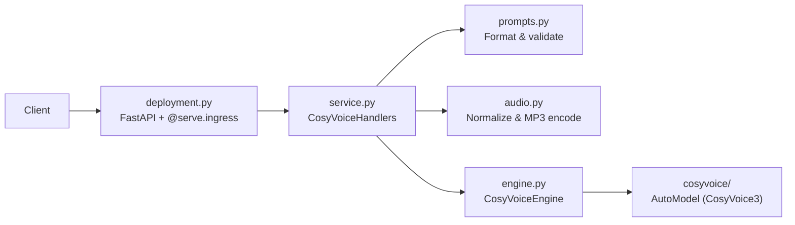

# Architecture

## Module Responsibilities

First-party code lives under `cosyvoice_api/` with explicit boundaries:

| Module | Responsibility |
| --- | --- |
| `cosyvoice_api/config.py` | Immutable `Settings` and `DeploymentSettings` loaded from environment variables, fixed sample-rate constants, and `assets/voices/` paths. No filesystem side effects on import. |
| `cosyvoice_api/prompts.py` | Pure CosyVoice3 `<|endofprompt|>` prompt/instruction formatters and speech-rate validation. |
| `cosyvoice_api/audio.py` | Tensor validation and peak normalization, FFmpeg reference resampling (16 kHz mono WAV), soundfile + FFmpeg LAME MP3 encoding via `asyncio.to_thread`, and `VoicePromptCache` for static built-in voices. |
| `cosyvoice_api/engine.py` | CUDA setup, Ray GPU assignment (`ray.get_gpu_ids()`), ModelScope download, lazy `AutoModel` import/initialization with CPU fallback, chunk iteration, and resource release. |
| `cosyvoice_api/service.py` | `CosyVoiceHandlers` (FastAPI route logic, request-scoped upload cleanup, response streaming, `reconfigure()`) and `create_asgi_app()` for standalone ASGI/unit testing. |
| `cosyvoice_api/deployment.py` | FastAPI `http_app`, `@serve.deployment(name="CosyVoiceAPI")`, `@serve.ingress(http_app)`, and the bound `app` object resolved by `serve run cosyvoice_api:app`. |
| `cosyvoice_api/__main__.py` | Local CLI runner (`python -m cosyvoice_api`) that configures stdout/file logging, starts Ray if needed, and runs Ray Serve in blocking mode. |

The vendored `cosyvoice/` directory is upstream CosyVoice (`074ca6dc9e80a2f424f1f74b48bdd7d3fea531cc`) and is treated as read-only. Because `cosyvoice/llm/llm.py` uses `Qwen2Encoder.forward_one_step` with a static mask slice that regresses under `transformers >= 4.53 / 5.x` (upstream issues `#1886`, `#1953`), `pyproject.toml` pins `transformers==4.51.3` rather than patching vendored code.

## Request Flow

1. FastAPI dispatches the request to the matching `CosyVoiceService` method.
2. `CosyVoiceHandlers` validates JSON or multipart inputs, parses `speed`, and resolves either a cached built-in voice clip (`VoicePromptCache`) or a request-scoped normalized reference clip.
3. Plain prompts are wrapped with CosyVoice3's `<|endofprompt|>` marker unless the client already supplied one:
   - `/tts` and `/cross_lingual_tts`: `You are a helpful assistant.<|endofprompt|>{text}`
   - `/zero_shot_tts` (`reference_text`): `You are a helpful assistant.<|endofprompt|>{reference_text}`
   - `/instruct_tts` (`instruction`): `You are a helpful assistant. {instruction}<|endofprompt|>`
4. `CosyVoiceEngine` runs the mapped `AutoModel` inference method, validating and peak-normalizing each audio tensor chunk.
5. Blocking `soundfile` WAV writes and FFmpeg LAME MP3 encoding run off the event loop via `asyncio.to_thread`. Streaming requests yield each encoded MP3 chunk; buffered requests concatenate CPU chunks and encode once.
6. Request-scoped temporary upload and normalized WAV files are removed in `finally` blocks once buffered encoding or streaming finishes.

## Endpoint-to-Model Mapping

| Endpoint | `AutoModel` Method | Key Forwarded Arguments | Prompt Source |
| --- | --- | --- | --- |
| `POST /tts` | `inference_cross_lingual` | `tts_text`, `prompt_wav`, `speed` | Built-in clip (`assets/voices/<voice>.wav`) |
| `POST /zero_shot_tts` | `inference_zero_shot` | `tts_text`, `prompt_text`, `prompt_wav`, `speed` | Uploaded clip + transcript |
| `POST /cross_lingual_tts` | `inference_cross_lingual` | `tts_text`, `prompt_wav`, `speed` | Uploaded clip |
| `POST /instruct_tts` | `inference_instruct2` | `tts_text`, `instruct_text`, `prompt_wav`, `speed` | Built-in clip (`assets/voices/<voice>.wav`) |

`AutoModel` inspects `cosyvoice3.yaml` in the model directory and instantiates `CosyVoice3` with `load_trt=False` and `load_vllm=False`.

## Audio Pipeline

| Constant | Value | Purpose |
| --- | --- | --- |
| `SAMPLE_RATE` | `24000` | CosyVoice3 synthesis output rate |
| `REFERENCE_AUDIO_SAMPLE_RATE` | `16000` | Normalized mono WAV input rate for prompt clips |

- **Reference normalization**: FFmpeg converts prompt audio to 16 kHz mono `pcm_s16le` WAV.
- **MP3 encoding**: `soundfile` writes `PCM_16` WAV (avoiding `torchaudio >= 2.9` TorchCodec ignoring encoding arguments), then FFmpeg encodes with `libmp3lame` at `-qscale:a 2`.
- **Caching vs. temporary files**: Built-in voice prompts are cached by `(voice_type, mtime)` in `VoicePromptCache` and cleared on shutdown. Uploaded reference clips are never retained in the cache; their raw and normalized files are deleted after each request completes.

## Replica Lifecycle

1. `@serve.deployment` configures autoscaling, concurrency caps, health checks, graceful shutdown, and `num_gpus` from environment variables at deployment definition time.
2. Each replica constructs `CosyVoiceEngine`, selects its assigned GPU via `ray.get_gpu_ids()` (falling back to CPU), downloads missing weights from ModelScope, and loads `AutoModel` with `fp16=True` on CUDA (falling back to CPU `fp16=False` on GPU init failure).
3. `reconfigure(config)` applies runtime `user_config` updates from `serve.update_config()`, validating `default_voice` against registered `voice_prompts` before switching.
4. An `atexit` hook releases the model, clears CUDA cache, and removes cached voice prompt WAVs on exit.
